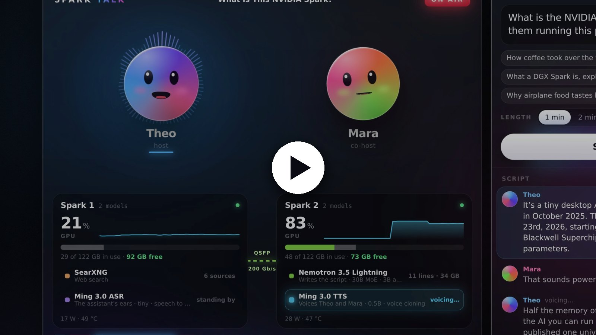
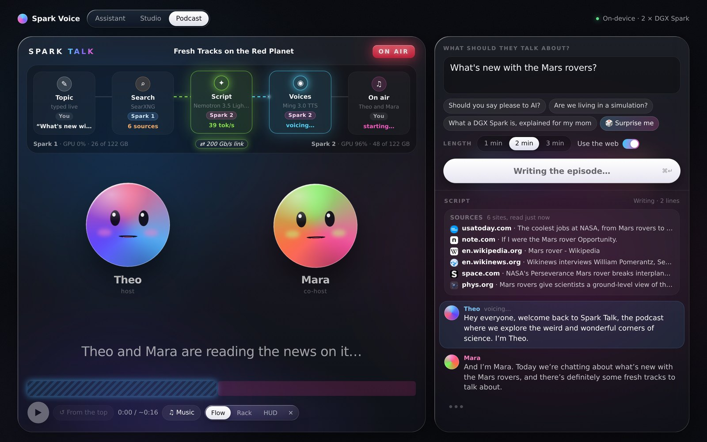
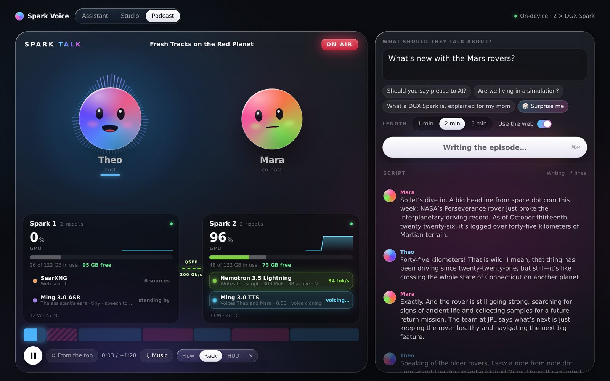
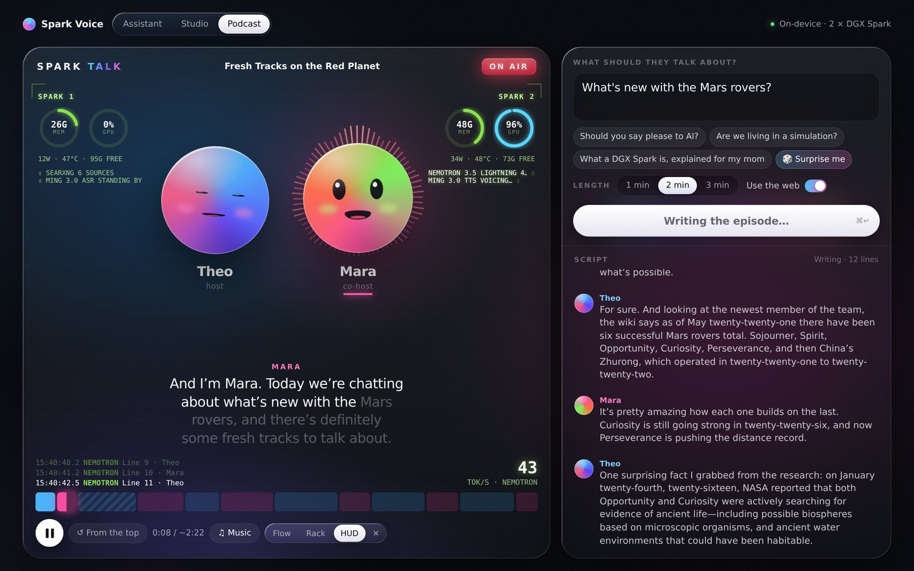
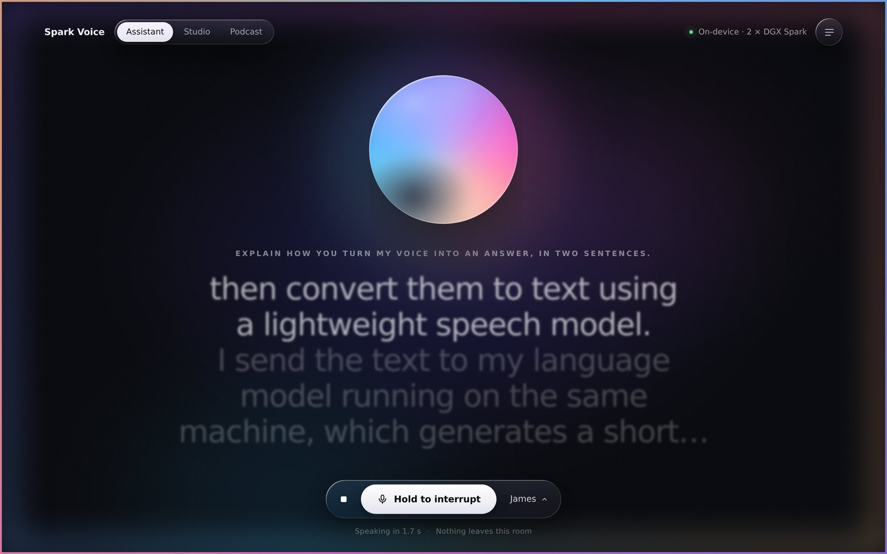
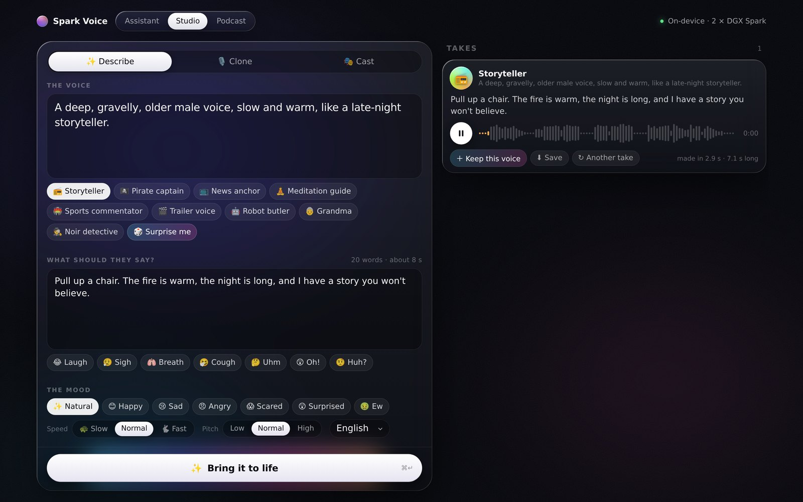

# Spark Voice

Three voice apps that run entirely on your own NVIDIA DGX Spark, with no cloud AI service:

- **Assistant** (`/`): talk to it, and it talks back. Speech to text, a chat model, then text to speech, sentence by sentence, so it starts answering in about a second.
- **Studio** (`/studio`): make a voice. Describe it ("a gravelly old sea captain"), clone it from 5–10 seconds of recording, or pick a built-in one. Then make it say anything, with a mood, pace and pitch.
- **Spark Talk** (`/podcast`): give two AI hosts a topic. They look it up on the web, write the episode and go on air in a few seconds, with captions, sources, and an **under the hood** view of what every model and machine is doing.

It runs on one DGX Spark, or splits across two.

[](https://github.com/joeynyc/spark-voice/releases/download/demo/spark-talk-demo.mp4)

*One unedited run (1:32): type a topic, and the hosts search the web, write the episode and go on air in under 6 seconds. Click to watch (MP4, 20 MB).*

## Screenshots

**Spark Talk, Flow view.** The pipeline lights up as each model works: search on Spark 1, then the script and the voices on Spark 2. The sources the hosts read are listed beside the script.



**Rack view.** Both Sparks live: GPU load, memory per model, and what each model is doing right now.



**HUD view.** Telemetry around the hosts: memory and GPU gauges, a running log of every step, and the writer's speed.



**Assistant.** Hold to talk (or type). Every stage is timed: hearing, the first word, the first sound.



**Studio.** Describe a voice, clone one, or pick from the cast, then set the mood.



## The models

| Job | Default model | Where it's from |
|---|---|---|
| Writes the scripts and answers | [NVIDIA Nemotron 3.5 Lightning](https://huggingface.co/nvidia/NVIDIA-Nemotron-3.5-Lightning-30B-A3B-NVFP4) (30B MoE, 3B active, NVFP4), served by vLLM | NVIDIA |
| Speaks | [Ming 3.0 TTS](https://huggingface.co/inclusionAI/Ming-3.0-tts-0.5B) (0.5B): voice cloning, voice design, moods | inclusionAI (MIT) |
| Listens | [Ming 3.0 ASR tiny](https://huggingface.co/inclusionAI/Ming-3.0-asr-tiny) | inclusionAI (MIT) |
| Looks things up | [SearXNG](https://github.com/searxng/searxng), self-hosted metasearch | SearXNG |

Every one of them can be swapped for your own. See [docs/models.md](docs/models.md).

Memory on one Spark: about 36 GB for Nemotron, 4 GB for the voices and 17 GB for the ears, so roughly half the Spark stays free.

## Quick start (one Spark)

```sh
git clone https://github.com/joeynyc/spark-voice && cd spark-voice
scripts/setup.sh
docker compose --profile app --profile models up -d
```

The first start builds the voice engines and downloads about 25 GB of models, which takes a while. Watch it with `docker compose logs -f`. When `docker compose ps` shows everything up, open **http://\<your-spark\>:7799**.

The microphone needs a secure page. On the Spark itself, `http://localhost:7799` works. From another computer, use HTTPS or an SSH tunnel (`ssh -L 7799:localhost:7799 <spark>`, then open `http://localhost:7799`). The podcast and the studio's typing features work over plain HTTP.

## Two Sparks

Put the models on one Spark and the app on the other: see [docs/two-sparks.md](docs/two-sparks.md).

## What's where

```
app/          the web app (FastAPI): assistant, studio, podcast, under-the-hood stats
  providers/  one adapter per job: llm, tts, asr, search
web/          the three pages
engines/      the Ming TTS and Ming ASR servers (with the DGX Spark fixes), the stats agent, SearXNG settings
voices/       the podcast hosts' reference clips (designed by Ming from text, not real people)
config.yaml   which model does each job and where it runs
compose.yaml  everything, as Docker Compose profiles
tools/recording/  record a 4K demo video of the podcast, with camera moves
```

## Ports

| Port | Service |
|---|---|
| 7799 | the app |
| 7798 | Ming TTS (also speaks the OpenAI `/v1/audio/speech` API) |
| 7797 | Ming ASR (also speaks the OpenAI `/v1/audio/transcriptions` API) |
| 7796 | stats agent |
| 7795 | SearXNG (localhost only) |
| 8000 | Nemotron on vLLM (OpenAI API) |

Change them in `.env`.

## Security

There are no accounts. By default:

- Only the app (port 7799) listens on your network. The model servers, the stats agent and SearXNG listen on
  localhost, or on the link between your Sparks in a two-Spark setup.
- Set `APP_TOKEN` in `.env` to require a password-like link (`http://<spark>:7799/?token=...`), for example on a
  shared network. Without it, anyone on your network can use the app and hear the voices you've saved.
- Web pages on other sites can't drive the app: cross-site requests and WebSockets are refused.
- The podcast's research only fetches public web pages (never addresses on your own network), with size and time limits.
- Model downloads are pinned to exact revisions.

Don't expose port 7799 to the internet. To use it away from home, use a VPN (for example Tailscale) or an SSH tunnel.

## License

MIT for this repo. The models have their own licenses: Ming 3.0 is MIT; Nemotron 3.5 Lightning is under the [OpenMDW license](https://openmdw.ai/license/1-1/).
